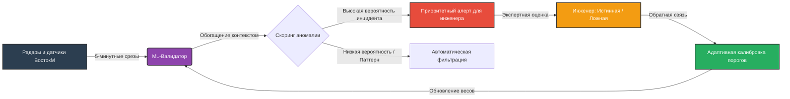

# TO BE: Целевое состояние системы

> **Видение проекта:** Превращение системы мониторинга из «генератора шумных алертов» в **интеллектуальный аналитический пайплайн** с непрерывным самообучением, который предоставляет инженерам только верифицированные инсайты, а разработчикам — математически обоснованные рекомендации по калибровке.

---

##  Как будет устроен новый процесс

Вместо прямого попадания всех отклонений на стол к инженеру, данные проходят через многоуровневую систему фильтрации и скоринга.

### Ключевые этапы нового процесса:
1. **Контекстное обогащение:** Сырые данные (скорость, интервалы, класс ТС) автоматически дополняются признаками времени суток, дня недели и погодных условий.
2. **ML-скоринг:** Легкая модель машинного обучения (например, Isolation Forest или Random Forest) оценивает каждую аномалию, выявленную базовым алгоритмом компании, и присваивает ей вероятность ложного срабатывания.
3. **Экспертная валидация (Human-in-the-Loop):** Инженер проверяет только те алерты, где уверенность модели низкая, или выборку для дообучения. Разметка занимает минуты, а не часы.
4. **Генерация рекомендаций:** Система автоматически формирует отчет для IT-отдела «ВостокМ» с конкретными предложениями по изменению порогов детекции для конкретных объектов.

