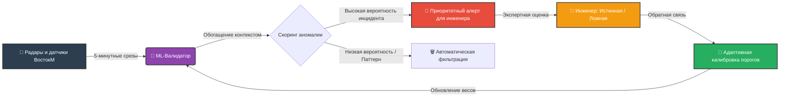

Вот красиво оформленный раздел **TO BE (Целевое состояние)** в формате Markdown. Он подчеркивает, что ваше решение — это именно **алгоритмический ML-пайплайн**, а не просто «дашборд», и отлично подойдет для вставки в отчет, презентацию или README на GitHub.

***

# 🚀 TO BE: Целевое состояние системы

> **Видение проекта:** Превращение системы мониторинга из «генератора шумных алертов» в **интеллектуальный аналитический пайплайн** с непрерывным самообучением, который предоставляет инженерам только верифицированные инсайты, а разработчикам — математически обоснованные рекомендации по калибровке.

---

## ⚡ Как будет устроен новый процесс

Вместо прямого попадания всех отклонений на стол к инженеру, данные проходят через многоуровневую систему фильтрации и скоринга.

### Ключевые этапы нового процесса:
1. **Контекстное обогащение:** Сырые данные (скорость, интервалы, класс ТС) автоматически дополняются признаками времени суток, дня недели и погодных условий.
2. **ML-скоринг:** Легкая модель машинного обучения (например, Isolation Forest или Random Forest) оценивает каждую аномалию, выявленную базовым алгоритмом компании, и присваивает ей вероятность ложного срабатывания.
3. **Экспертная валидация (Human-in-the-Loop):** Инженер проверяет только те алерты, где уверенность модели низкая, или выборку для дообучения. Разметка занимает минуты, а не часы.
4. **Генерация рекомендаций:** Система автоматически формирует отчет для IT-отдела «ВостокМ» с конкретными предложениями по изменению порогов детекции для конкретных объектов.

---

## 📊 Сравнение метрик: AS IS ➡️ TO BE

| Показатель | 🔴 AS IS (Текущее состояние) | 🟢 TO BE (Целевое состояние) |
| :--- | :--- | :--- |
| **Время проверки 1 алерта** | ~40 минут (ручной анализ Excel/видео) | **~10 минут** (готовый скоринг и контекст) |
| **Доля ложных срабатываний** | 30–40% (шум, ночные стоянки фур) | **≤ 20%** (отсечение паттернов на уровне ML) |
| **Точность детекции (F1-score)** | ~0.60 – 0.65 | **≥ 0.80** |
| **Использование архива данных** | < 20% (только базовая статистика) | **> 80%** (ретроспективный анализ и обучение) |
| **Обратная связь с алгоритмом** | Отсутствует (статичные пороги) | **Непрерывная** (адаптивная калибровка) |

---

## 🎯 Ценность для стейкхолдеров

### 🚦 Для транспортных инженеров (Конечные пользователи)
* **Фокус на главном:** Система сама отсеивает «ночные отстои» и «погодные замедления». Инженер видит только реальные инциденты.
* **Экономия времени:** Сокращение рутины на **75%**. Освободившиеся часы направляются на стратегическое планирование ремонтов и управление КДМ.
* **Прозрачность:** Понимание *почему* система выдала алерт (наглядный вклад каждого фактора).

### 💻 Для IT-отдела «ВостокМ» (Заказчик)
* **Математическая калибровка:** Вместо интуитивной настройки порогов — точные рекомендации на основе данных (например: *«На объекте №42 увеличить ночной порог интенсивности на 15%»*).
* **Активация темных данных:** 5-летний архив пятиминутных срезов превращается из «балласта» в обучающую выборку для улучшения продукта.
* **Рост качества продукта:** Снижение шума повышает доверие клиентов (дорожных служб) к системе мониторинга.

### 🎓 Для команды проекта (Исполнители)
* **Реальный ML-опыт:** Работа с промышленными Big Data, feature engineering и валидацией алгоритмов в условиях ограничений КИИ.
* **Измеримый результат:** Четкие метрики успеха (F1-score, False Positive Rate), которые можно защитить перед экспертами.

---

## 🛠 Технологический стек TO BE

* **Язык и среда:** Python 3.9+, Jupyter Notebook / Streamlit (для демо-интерфейса разметки).
* **Обработка данных:** `pandas`, `numpy` (агрегация, очистка, feature engineering).
* **Машинное обучение:** `scikit-learn` (Isolation Forest / Random Forest для скоринга аномалий).
* **Визуализация:** `plotly`, `matplotlib` (интерактивные графики отклонений).
* **Хранение и интеграция:** `PostgreSQL` (через `SQLAlchemy`), локальное хранение разметки (SQLite/CSV) для безопасности КИИ.

***

**💡 Совет:** Если вы вставляете это в GitHub README, диаграмма Mermaid отрендерится автоматически. Если в Word/PDF для отчета — просто сделайте скриншот диаграммы на [mermaid.live](https://mermaid.live) и вставьте её как картинку.
